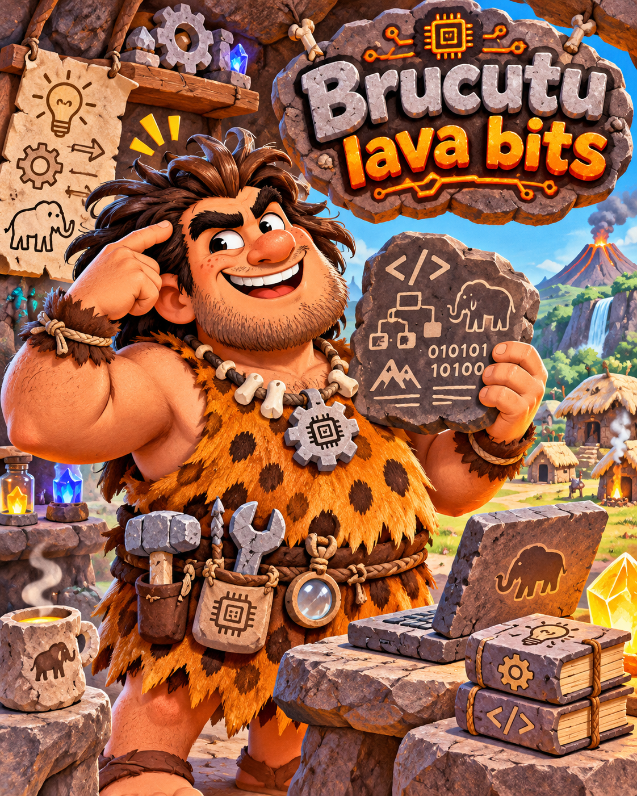

# Brucutu Lava Bits

> **Da idade da pedra à engenharia de software.**

  

  <a href="trilhas/iniciante.md">Comece pela trilha iniciante</a> ·
  <a href="docs/03-arquitetura/o-que-e-arquitetura-de-software.md">Leia o primeiro artigo</a> ·
  <a href="CONTRIBUTING.md">Contribua</a>

## O que é o Brucutu?

O Brucutu Lava Bits é um portfólio educacional open source sobre engenharia de software, escrito em português brasileiro para quem está começando, consolidando fundamentos ou aprofundando sua prática.

Nossa missão é transformar conceitos difíceis em conhecimento aplicável: explicar **o quê**, **por quê**, **como**, **quando usar** e quais são os **trade-offs** — as compensações e consequências entre escolhas — de cada decisão. O humor pré-histórico é um tempero — a precisão técnica é a pedra fundamental.

> **Nota sobre os exemplos:** os trechos usam .NET/C# como linguagem de demonstração, mas os conceitos são agnósticos de linguagem e podem ser aplicados em outras tecnologias com adaptações de sintaxe, bibliotecas e convenções.

  

## Uma ideia simples: aprender evoluindo

Aprender engenharia de software não é decorar ferramentas nem repetir receitas. É construir modelos mentais, testar hipóteses, observar consequências e evoluir decisões.

Aqui, a jornada vai da **pedra fundamental** aos sistemas que precisam sobreviver a mudanças, integrações, escala e manutenção. Cada conteúdo busca conectar conceito e prática, deixando claro o que é uma simplificação didática e o que é uma recomendação para produção.

 

## Filosofia

- Fundamentos antes de ferramentas.
- Exemplos progressivos, claros e honestos sobre suas simplificações.
- Boas práticas com contexto, não como dogmas.
- Trade-offs explícitos: toda decisão tem custo, benefício e cenário.
- Evolução contínua: refatorar é parte normal da espécie do software.
- Segurança, acessibilidade e manutenção desde o início.

Quando aparecer código fossilizado, vamos examiná-lo com cuidado. Quando houver uma ferramenta evoluída, vamos entender por que ela ajuda — e quando ela pode ser excesso.

## Identidade visual

As imagens iniciais do projeto ficam em [`docs/imagens/`](docs/imagens/). A pasta concentra materiais visuais globais do portfólio; imagens específicas de diagramas, banners institucionais ou outros usos podem ser organizadas em suas pastas próprias quando necessário.

| Elemento | Uso atual |
| --- | --- |
| `brucuto-genio.png` | Imagem principal de apresentação do README |
| `brucutu-ideia.png` | Apoio visual à missão educacional |
| `icone.png` | Ícone/mascote em fundo transparente |

## Áreas de conhecimento

| Área | O que você encontra | Entrada |
| --- | --- | --- |
| Fundamentos | Conceitos essenciais para raciocinar sobre software | [Explorar fundamentos](docs/00-fundamentos/) |
| Boas práticas | Legibilidade, manutenção e evolução da base de código | [Explorar boas práticas](docs/01-boas-praticas/) |
| Orientação a objetos | Modelagem, responsabilidades e colaboração entre objetos | [Explorar orientação a objetos](docs/02-orientacao-objetos/) |
| Arquitetura | Decisões, componentes, dependências e qualidade | [Explorar arquitetura](docs/03-arquitetura/) |
| APIs e integrações | Contratos, comunicação entre sistemas e resiliência | [Explorar APIs e integrações](docs/04-apis-e-integracoes/) |
| Testes | Confiança, feedback e estratégias de verificação | [Explorar testes](docs/05-testes/) |
| Bancos de dados | Persistência, consistência, modelagem e desempenho | [Explorar bancos de dados](docs/06-bancos-de-dados/) |
| Cloud e DevOps | Entrega, operação, observabilidade e automação | [Explorar Cloud e DevOps](docs/07-cloud-e-devops/) |
| Inteligência artificial | Conceitos, uso responsável e integração com software | [Explorar inteligência artificial](docs/08-inteligencia-artificial/) |

## Trilhas de aprendizagem

- [Trilha iniciante](trilhas/iniciante.md): construa sua pedra fundamental.
- [Trilha intermediário](trilhas/intermediario.md): evolua práticas e decisões.
- [Trilha avançado](trilhas/avancado.md): lide com escala, incerteza e trade-offs sistêmicos.

As trilhas combinam artigos disponíveis com etapas planejadas. Conteúdos futuros aparecem identificados como **planejados**, sem links artificiais para páginas que ainda não existem.

## Laboratórios práticos

Os [laboratórios](laboratorios/README.md) são desafios da caverna: pequenos experimentos para aplicar uma ideia, observar seus efeitos e registrar o que foi aprendido. Cada laboratório deverá informar objetivo, pré-requisitos, passos, resultado esperado e perguntas de reflexão.

## Como estudar

1. Escolha uma trilha compatível com seu momento.
2. Leia o conceito antes de copiar o código.
3. Reproduza o exemplo em um ambiente seguro.
4. Faça o desafio da caverna e altere uma variável por vez.
5. Anote decisões, dúvidas e trade-offs percebidos.
6. Volte ao conteúdo depois de praticar: a segunda leitura costuma revelar fósseis interessantes.

## Como contribuir

Leia o [guia de contribuição](CONTRIBUTING.md) e as [instruções permanentes para agentes](AGENTS.md). Você pode propor correções, exemplos, novos artigos, laboratórios ou melhorias de acessibilidade. Toda contribuição deve preservar o tom didático, a precisão técnica e os links válidos.

## Status do projeto

**Fundação inicial em construção.** A estrutura editorial, as trilhas iniciais, o primeiro artigo, os templates e as primeiras imagens estão disponíveis. Novos conteúdos, laboratórios executáveis e artigos serão adicionados gradualmente.

## Licença

A licença ainda não foi definida. Consulte [LICENSE-PENDENTE.md](LICENSE-PENDENTE.md) antes de reutilizar o conteúdo.
