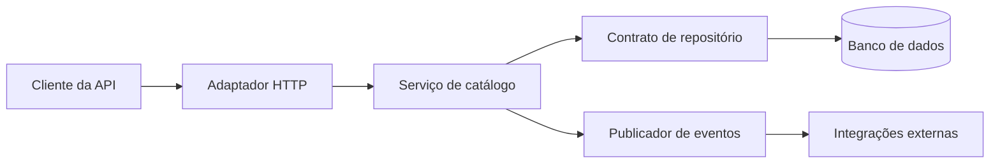

# O que é arquitetura de software?

> **Resumo:** arquitetura de software é o conjunto de decisões importantes sobre a forma como um sistema é dividido, como seus componentes colaboram e quais qualidades ele precisa sustentar. Ela orienta a evolução do sistema sem se reduzir a pastas, frameworks ou diagramas bonitos.

Neste artigo, **trade-offs** significa as compensações e consequências que surgem quando uma escolha favorece uma qualidade, mas pode aumentar um custo ou limitar outra.

<small>Na tecnologia, um <strong>trade-off</strong> é a famosa “escolha de Sofia”: quando você precisa abrir mão de uma coisa boa para conseguir outra que é mais importante naquele momento.</small>

## Público-alvo e pré-requisitos

- **Público-alvo:** estudantes e desenvolvedores iniciantes ou intermediários que já conhecem funções, módulos e APIs básicas.
- **Pré-requisitos:** noções de programação e de sistemas que trocam dados por uma interface.

## Objetivos de aprendizagem

Ao final, você deverá conseguir:

- distinguir arquitetura de organização de pastas e de escolha de framework;
- identificar componentes, dependências, responsabilidades e decisões arquiteturais;
- relacionar requisitos funcionais e não funcionais a trade-offs concretos.

## Problema que queremos resolver

Um sistema pode funcionar hoje e ainda assim ser caro, arriscado ou lento de evoluir. Sem decisões explícitas, responsabilidades acabam misturadas, dependências formam um emaranhado e qualidades importantes — como segurança, disponibilidade e desempenho — aparecem tarde demais.

Arquitetura ajuda a responder perguntas de alto impacto: onde uma regra deve viver? Quem pode depender de quem? O que acontece quando o catálogo fica indisponível? Como uma decisão pode ser substituída no futuro?

## Pedra fundamental: definição técnica

Arquitetura de software é a organização fundamental de um sistema, expressa por seus componentes, relações, responsabilidades, restrições e decisões que influenciam sua forma e evolução. Não é apenas um desenho: é um conjunto de escolhas e justificativas.

Um **componente** é uma unidade com uma responsabilidade reconhecível. Uma **dependência** existe quando uma parte precisa de outra para cumprir seu contrato. Uma **decisão arquitetural** registra uma escolha relevante, suas alternativas e suas consequências.

Requisitos **funcionais** descrevem o que o sistema faz, como consultar produtos. Requisitos **não funcionais** descrevem qualidades ou restrições, como tempo de resposta, disponibilidade, segurança, custo e capacidade de manutenção. Qualidade não é um adorno: ela muda o desenho e a operação do sistema.

## Analogia do Brucutu

Construir uma caverna segura não é apenas escolher pedras bonitas. É decidir onde fica a entrada, como a água escoa, qual parede suporta o teto, por onde as pessoas circulam e o que acontece quando a tribo cresce.

O desenho da caverna representa as relações entre partes; as regras de construção representam restrições; a decisão de reforçar uma parede tem um custo, mas evita um desabamento. Do mesmo modo, arquitetura é planejamento técnico para reduzir riscos importantes — não um mapa obrigatório de cada pedregulho.

## Componentes, dependências e responsabilidades

Considere uma API de catálogo. Uma decomposição possível é:



- O **adaptador HTTP** traduz requisições e respostas do protocolo para o modelo da aplicação.
- O **serviço de catálogo** coordena o caso de uso e protege regras de negócio.
- O **contrato de repositório** expressa o que o caso de uso precisa, sem obrigá-lo a conhecer detalhes do banco.
- O **banco de dados** persiste dados; não deve decidir sozinho regras que pertencem ao domínio.
- O **publicador de eventos** comunica fatos relevantes para integrações que não precisam bloquear a resposta principal.

Essa divisão é uma hipótese arquitetural, não uma receita universal. Um sistema pequeno pode começar com menos componentes; um sistema crítico pode exigir isolamento, filas ou controles adicionais.

## Requisitos e decisões arquiteturais

Imagine os seguintes requisitos para o catálogo:

| Tipo | Exemplo | Consequência possível |
| --- | --- | --- |
| Funcional | Consultar produtos por categoria | Endpoint, caso de uso e consulta indexada |
| Funcional | Cadastrar preço | Regra de validação, autorização e persistência |
| Não funcional | Responder 95% das consultas em até 200 ms | Cache, índices, medição e orçamento de latência |
| Não funcional | Continuar consultável durante falha parcial | Réplicas, timeouts, fallback e observabilidade |
| Não funcional | Restringir alteração de preço | Autenticação, autorização, auditoria e proteção de dados |

Uma decisão madura registra o problema, alternativas consideradas, escolha e consequências. Por exemplo: “começar com um monólito modular para reduzir complexidade operacional; manter contratos internos claros para permitir extração futura se a escala ou autonomia das equipes justificar”.

## Código fossilizado

O exemplo abaixo mistura transporte HTTP, regra de negócio e persistência. Ele usa C# com uma API no estilo ASP.NET Core e é propositalmente simplificado para mostrar o cheiro, não para ser copiado para produção:

```csharp
// Exemplo didático simplificado — não recomendado para produção.
[HttpPut("produtos/{id:guid}/preco")]
public IActionResult AtualizarPreco(Guid id, AlterarPrecoRequest request)
{
    var produto = _dbContext.Produtos.Find(id);
    if (produto is null)
    {
        return NotFound();
    }

    produto.Preco = request.Preco;
    _dbContext.SaveChanges();
    _emailSender.Send("Preço alterado");

    return Ok(produto);
}
```

Problemas possíveis: validação e autorização não aparecem, o formato HTTP invade a regra, o acesso ao banco está acoplado ao caso de uso e o envio de e-mail pode tornar a resposta lenta ou falhar junto com a alteração. O trecho também não define auditoria, idempotência ou tratamento de concorrência.

## Evolução: solução comentada

Uma evolução didática separa responsabilidades e torna as decisões visíveis. Os contratos abaixo são intencionalmente resumidos para destacar a direção das dependências:

```csharp
public sealed record AlterarPrecoRequest(decimal Preco);
public sealed record AlterarPrecoCommand(Guid ProdutoId, decimal Preco);

// Adaptador: traduz HTTP para o comando da aplicação.
[HttpPut("produtos/{id:guid}/preco")]
public async Task<ActionResult<ProdutoResponse>> AtualizarPreco(
    Guid id,
    AlterarPrecoRequest request,
    CancellationToken cancellationToken)
{
    if (!User.HasClaim("permission", "catalogo.preco.editar"))
    {
        return Forbid();
    }

    var command = new AlterarPrecoCommand(id, request.Preco);
    var produto = await _catalogo.AlterarPrecoAsync(command, cancellationToken);

    return Ok(ProdutoResponse.From(produto));
}

// Aplicação: coordena o caso de uso.
public async Task<Produto> AlterarPrecoAsync(
    AlterarPrecoCommand command,
    CancellationToken cancellationToken)
{
    ValidarPreco(command.Preco);

    var produto = await _repositorio.BuscarPorIdAsync(
        command.ProdutoId,
        cancellationToken);

    if (produto is null)
    {
        throw new ProdutoNaoEncontradoException(command.ProdutoId);
    }

    produto.AlterarPreco(command.Preco);
    await _repositorio.SalvarAsync(produto, cancellationToken);
    await _auditoria.RegistrarAsync("preco_alterado", produto.Id, cancellationToken);
    await _eventos.PublicarDepoisDaTransacaoAsync(
        new ProdutoAtualizado(produto.Id),
        cancellationToken);

    return produto;
}
```

Este código continua sendo uma ilustração: os campos privados, registros, contratos e configurações de infraestrutura foram omitidos. Em produção, seria necessário definir transações, autenticação real, autorização robusta, concorrência, observabilidade, proteção contra abuso, tratamento de falhas e testes. A separação ajuda porque cada decisão pode ser examinada e testada, mas também adiciona conceitos e código.

## Trade-offs e quando **não** utilizar

- Mais camadas podem melhorar isolamento, mas aumentam indirection e custo cognitivo.
- Eventos desacoplam integrações, mas trazem consistência eventual, observabilidade e reprocessamento.
- Cache reduz latência, mas introduz invalidação, dados potencialmente desatualizados e custo operacional.
- Microsserviços podem dar autonomia e escala seletiva, mas adicionam rede, deploys, contratos distribuídos e operação.
- Um monólito modular pode ser a melhor escolha inicial quando o domínio ainda está sendo descoberto ou a equipe é pequena.

Não crie uma arquitetura distribuída apenas porque ela parece mais avançada. Não transforme cada classe em um componente arquitetural. A escolha deve responder a riscos e requisitos reais, com margem para evolução.

## Erros comuns

- Confundir arquitetura com árvore de diretórios.
- Escolher um framework antes de entender requisitos e restrições.
- Desenhar componentes sem responsabilidades ou contratos claros.
- Tratar requisitos não funcionais como “detalhes para depois”.
- Copiar uma arquitetura famosa sem considerar equipe, domínio, orçamento e operação.
- Ignorar decisões e registrar apenas o diagrama final, sem as alternativas descartadas.

## Desafio da caverna

Escolha um sistema pequeno, como uma lista de tarefas. Desenhe três componentes, escreva uma responsabilidade para cada um e registre duas decisões: uma funcional e uma não funcional. Depois, responda: o que mudaria se a lista precisasse funcionar offline?

Critério de sucesso: cada componente tem uma responsabilidade compreensível, as dependências têm direção e pelo menos um trade-off está explícito.

## Resumo

Arquitetura trata de decisões estruturais, responsabilidades, relações e qualidades do sistema. Ela não se confunde com pastas nem com frameworks. Uma boa arquitetura é adequada ao contexto, torna riscos visíveis e permite evolução consciente.

## Próximos estudos

- Conteúdo relacionado já disponível: [trilha intermediária](../../trilhas/intermediario.md).
- Conteúdo planejado: requisitos não funcionais em profundidade, contratos de API, observabilidade e evolução de arquiteturas.
