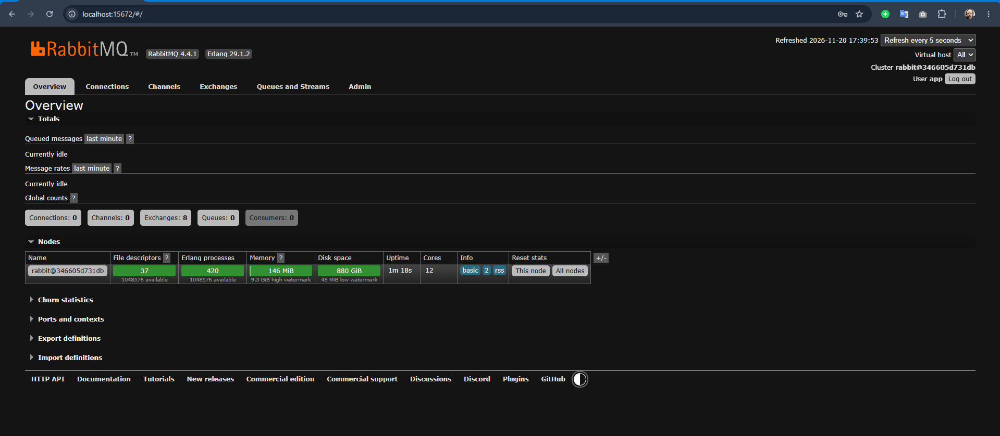

# 5. Explorando o RabbitMQ Management

## Objetivo

Usar o painel para enxergar a topologia que antes aparecia apenas no código: conexões, canais, exchanges, bindings, filas, consumidores e mensagens.

<small>O código conta a intenção da tribo; o painel mostra as pegadas que realmente ficaram na caverna.</small>

Suba primeiro o [ambiente local](ambiente-local/README.md) e abra <http://localhost:15672> com `app` e `app-secret`.



## 1. Leia a tela Overview

Observe:

1. **Connections**, conexões TCP abertas pelas aplicações;
2. **Channels**, sessões lógicas dentro das conexões;
3. **Exchanges**, pontos que recebem e roteiam mensagens;
4. **Queues**, buffers que armazenam mensagens para os consumers;
5. **Consumers**, processos registrados para consumir filas;
6. contadores de mensagens prontas e não confirmadas;
7. alertas de memória, disco e saúde do nó.

Muitas conexões podem indicar que a aplicação abre uma conexão por operação. Muitas mensagens acumuladas podem indicar consumer parado ou lento. Um painel não explica sozinho a causa, mas aponta onde começar.

## 2. Crie uma exchange

1. Acesse **Exchanges**.
2. Escolha o virtual host `/`.
3. Em **Add a new exchange**, informe `orders.events`.
4. Escolha o tipo `direct`.
5. Marque **Durable**.
6. Clique em **Add exchange**.

Use `direct` quando a routing key precisa corresponder exatamente. Depois, repita o exercício com `topic` e observe como padrões como `orders.*` e `orders.#` mudam o roteamento.

## 3. Crie uma fila e um binding

1. Acesse **Queues and Streams**.
2. Crie a fila durável `orders.created.worker`.
3. Abra a fila e acesse **Bindings**.
4. Adicione um binding vindo de `orders.events`.
5. Use a routing key `orders.created`.

A exchange só entregará a mensagem quando houver um binding compatível. Declarar uma exchange sem binding é como colocar uma placa na trilha e esquecer de construir a estrada.

## 4. Publique e leia manualmente

Na exchange, abra **Publish message** e informe:

- routing key: `orders.created`;
- payload: `{"orderId":"ord-001","total":42.50}`.

Depois abra a fila, expanda **Get messages** e faça uma leitura manual. Essa operação serve para experimentar a topologia. Em uma aplicação, o publisher e o consumer devem executar pelo código, com contrato, logs e confirmação apropriados.

## 5. Configure usuários e permissões

Em **Admin**:

- crie um usuário separado para a aplicação;
- conceda acesso apenas ao virtual host necessário;
- evite usar um usuário administrativo no código;
- não versione credenciais reais em `.env`, compose ou documentação pública.

As credenciais padrão existem somente para o laboratório local.

## 6. Diagnóstico rápido

### A mensagem não chega

Revise exchange, tipo, binding e routing key. Em `direct`, a correspondência é exata.

### A fila cresce

Verifique se há consumer, se o processamento está lento e se o `prefetch` está adequado. Compare mensagens prontas com mensagens não confirmadas.

### O painel não abre

```powershell
docker compose -f laboratorios/arquitetura-mensageria-observavel/ambiente-local/rabbitmq/docker-compose.yml ps
docker compose -f laboratorios/arquitetura-mensageria-observavel/ambiente-local/rabbitmq/docker-compose.yml logs rabbitmq
```

### A aplicação não conecta

Fora do Docker, use `localhost:5672`. Dentro do mesmo Compose, o host normalmente será o nome do serviço, não `localhost`.

## Perguntas de reflexão

- Qual parte do fluxo pertence ao publisher, ao exchange e ao consumer?
- O que a tela mostra que o log da aplicação não mostra?
- O que acontece com uma mensagem publicada sem binding?
- Qual sinal indicaria que o consumer está processando mensagens lentamente?

## Referência

- [RabbitMQ .NET/C# Client API Guide](https://www.rabbitmq.com/client-libraries/dotnet-api-guide)
