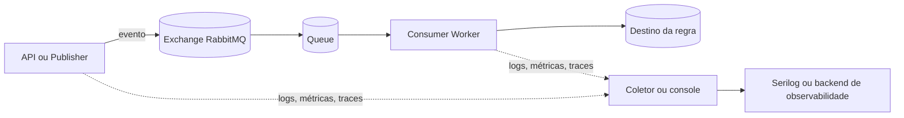

# Laboratório: arquitetura de mensageria e observabilidade

> **Resumo:** vamos construir uma arquitetura demo pequena para entender quando RabbitMQ, telemetria, logs estruturados, métricas, traces e Serilog ajudam de verdade. O laboratório privilegia perguntas observáveis e evolução incremental, não uma coleção de ferramentas para impressionar a tribo.

## Objetivo e pergunta investigada

Construir um fluxo em que um publisher publica um evento, um consumer processa a mensagem e a equipe consegue responder:

- A mensagem foi publicada, roteada, consumida e processada?
- Quanto tempo cada etapa levou?
- O que acontece quando o consumer falha?
- Como encontrar uma mensagem específica sem registrar dados sensíveis?
- Qual problema cada ferramenta resolve e qual custo ela adiciona?

<small>RabbitMQ leva a mensagem pela caverna; telemetria deixa pegadas; observabilidade ajuda a descobrir onde o dinossauro tropeçou.</small>

*Imagem conceitual do laboratório. A topologia técnica e os nomes dos sinais estão detalhados no diagrama Mermaid abaixo.*

## Arquitetura da demo

O fluxo pode começar apenas com console e RabbitMQ. Depois adicionamos sinais e falhas de propósito. A arquitetura é educacional, não uma prescrição de microsserviços.

## Pré-requisitos e ambiente seguro

- .NET 8 ou superior instalado;
- Docker Desktop ou RabbitMQ local;
- terminal e duas janelas para executar publisher e consumer;
- noções básicas de `async`, JSON e injeção de dependência.

Para o primeiro experimento, use credenciais locais e dados fictícios. Não coloque senhas, tokens ou dados pessoais nas mensagens nem nos logs.

## Roteiro

1. Leia [Mensageria com RabbitMQ](01-mensageria-rabbitmq.md) e publique uma mensagem simples.
2. Adicione um consumer com confirmação manual, limite de concorrência e tratamento de erro.
3. Leia [Telemetria](02-telemetria.md) e crie uma atividade para o fluxo de publicação e consumo.
4. Leia [Observabilidade e Serilog](03-observabilidade-e-serilog.md) e substitua mensagens soltas por logs estruturados.
5. Execute o [desafio integrado](04-desafio-integrado.md), provocando falhas e registrando evidências.
6. Suba o [ambiente local](ambiente-local/README.md) e explore o painel do RabbitMQ.
7. Compare a experiência com [SQS no MiniStack](06-sqs-com-ministack.md).

## Complemento: ambiente local e duas formas de mensageria

- [RabbitMQ Management](05-rabbitmq-management.md): exchanges, bindings, filas, usuários, permissões e diagnóstico pelo painel.
- [SQS com MiniStack](06-sqs-com-ministack.md): filas padrão, FIFO, visibilidade, confirmação, DLQ e polling por API.
- [Ambiente local](ambiente-local/README.md): comandos para iniciar, verificar e limpar os serviços sem usar uma conta AWS real.

## Resultado esperado

Ao terminar, deve ser possível demonstrar:

- um publisher e um consumer funcionando;
- uma mensagem com identificador e tipo explícitos;
- `ack` somente depois do processamento bem-sucedido;
- `nack` ou encaminhamento para uma fila de erro em falhas tratáveis;
- logs com propriedades estruturadas;
- métricas de mensagens publicadas, processadas, falhas e duração;
- um trace ou correlação que conecte publicação e consumo.
- uma comparação registrada entre o modelo de broker do RabbitMQ e o modelo de filas acessadas por API do SQS.

## Critérios de sucesso

- O consumer pode ser reiniciado sem perder silenciosamente uma mensagem confirmada apenas após o processamento.
- Uma falha é visível sem precisar adivinhar em qual processo ocorreu.
- O laboratório explica quando cada componente é necessário e quando seria excesso.
- O fluxo pode ser limpo e repetido sem depender de estado secreto na máquina.

## Facilitadores de padronização

Depois de entender o fluxo, podemos criar métodos genéricos, snippets ou templates para:

- serializar e publicar eventos;
- aplicar cabeçalhos de correlação;
- iniciar atividades e métricas;
- confirmar, rejeitar e encaminhar mensagens;
- registrar logs com propriedades comuns.

Esses facilitadores devem esconder repetição mecânica, não esconder decisões como idempotência, política de retry, contrato de mensagem ou destino de erro. Uma abstração que elimina a compreensão do fluxo é só uma caverna com iluminação ruim.

## Limpeza do ambiente

Ao terminar, pare os processos locais e remova filas e containers criados exclusivamente pelo laboratório. Não apague volumes ou recursos compartilhados sem confirmar o alvo.

## Próximos estudos

- [RabbitMQ .NET/C# Client API Guide](https://www.rabbitmq.com/client-libraries/dotnet-api-guide)
- [Observabilidade, logs e métricas](../../docs/07-cloud-e-devops/observabilidade-logs-e-metricas.md)
- [Idempotência e duplicidade](../../docs/04-apis-e-integracoes/idempotencia-e-duplicidade.md)
