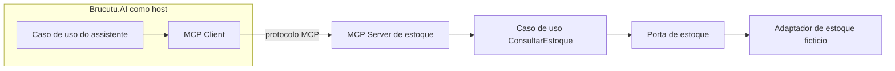

# 8. MCP Server e MCP Client

> **Resumo:** uma ferramenta útil pode atender diferentes aplicações de IA. MCP oferece um protocolo comum para descoberta e uso dessas capacidades, preservando os controles da aplicação.

## Pedra fundamental

**MCP**, de *Model Context Protocol* (protocolo de contexto para modelos), padroniza a troca de contexto e o acesso a capacidades entre aplicações e servidores. Ele não é um modelo de IA e não substitui a orquestração do agente.

<small>É um padrão para os encaixes das ferramentas. O encaixe combinar não significa que qualquer visitante pode usar a furadeira da tribo.</small>

| Participante | Papel no laboratório |
| --- | --- |
| **Host (aplicação hospedeira)** | O assistente que coordena a interação, o modelo e as políticas de acesso |
| **MCP Client (cliente MCP)** | Componente do host que se comunica com um servidor |
| **MCP Server (servidor MCP)** | Expõe capacidades por meio do protocolo, local ou remotamente |

Um servidor pode oferecer **tools (ferramentas executáveis)**, **resources (recursos de dados)** e **prompts (modelos reutilizáveis de interação)**. O exercício começa por uma ferramenta de leitura. As capacidades disponíveis dependem do servidor e do cliente. [Referência: arquitetura MCP](https://modelcontextprotocol.io/docs/learn/architecture).

## O problema e o encaixe arquitetural

Queremos expor a consulta ao estoque para outro host e permitir que o Brucutu.AI consuma uma ferramenta de um servidor externo controlado.

O servidor MCP funciona como adaptador de entrada: traduz uma chamada do protocolo para o caso de uso existente. O cliente MCP funciona como adaptador de saída: implementa uma porta usada pela aplicação. Nenhum deles leva regras de estoque para dentro do transporte.

O diagrama mostra o fluxo de execução. A autorização deve existir no servidor, mesmo quando o host também aplica suas próprias restrições.

## Experimento proposto

**Pré-requisito:** contrato da ferramenta da [etapa 6](06-function-calling.md). A autonomia da etapa 7 é opcional para testar o protocolo.

1. Escolher implementações compatíveis, registrar versões do protocolo e do SDK e expor somente `ConsultarEstoque`, reutilizando o caso de uso.
2. Conectar um cliente e verificar descoberta, nome, descrição, contrato de argumentos e resultado. Receber uma descrição não concede autorização para executar.
3. Fazer uma chamada permitida e outra negada, usando identidade verificável no servidor. Comparar com a mesma operação pela API.
4. Configurar o Brucutu.AI como host com cliente MCP para um servidor de teste controlado. Simular indisponibilidade e retorno inválido, mantendo limites de tempo e tamanho.

**Stdio (entrada e saída padrão)** permite comunicação entre processos locais. **Streamable HTTP (transporte HTTP com suporte a fluxo)** atende comunicação por HTTP. A escolha muda implantação e controles: um processo local precisa de permissões mínimas e ambiente restrito; um servidor remoto exige canal protegido, autenticação e autorização adequadas. Fixar a versão evita misturar exemplos de revisões diferentes do protocolo.

## Evidências e critérios de sucesso

- O cliente descobre e chama a ferramenta sem depender de detalhes internos do servidor.
- A mesma regra de acesso vale por HTTP e MCP.
- O host aceita apenas servidores configurados e capacidades autorizadas.
- Descrições e resultados são tratados como conteúdo não confiável, com validação antes do uso.

## Vantagens, limitações e erros comuns

MCP favorece interoperabilidade e reutilização. Acrescenta contratos de protocolo, compatibilidade e operação de integrações. Não fornece confiança automática nem obriga o modelo a escolher a ferramenta correta.

Function calling estrutura a solicitação do modelo; MCP conecta aplicações a capacidades. Podem trabalhar juntos. Para uma função interna usada por uma única aplicação, uma chamada direta pode continuar suficiente.

**Desafio da caverna:** um servidor oferece uma ferramenta nova após uma atualização. Explique por que descobri-la não deve colocá-la automaticamente na lista de ações permitidas.

[Anterior: agentes inteligentes](07-agentes-inteligentes.md) · [Visão geral](README.md) · [Próxima: segurança, observabilidade e custos](09-seguranca-observabilidade-e-custos.md)
