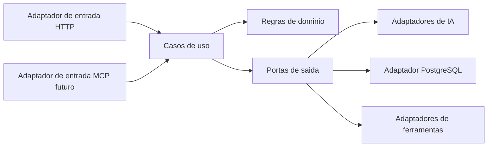

# Brucutu.AI

> **Enterprise Generative AI Playground:** um ambiente de experimentação de IA generativa para cenários empresariais, construído uma pedra de cada vez.

Vamos acompanhar o **assistente da tribo**: ele começa respondendo perguntas, aprende a consultar documentos e ferramentas e evolui para executar tarefas com limites explícitos. O objetivo é entender o que cada peça resolve, como se encaixa na arquitetura e qual conta deixa para a tribo pagar.

<small>O mamute ganhou um assistente. A responsabilidade pelo portão da caverna continua sendo nossa.</small>

## O que está disponível

Esta entrega contém **explicações conceituais e roteiros de experimentos** para nove etapas. A API, os projetos .NET, as migrações, os testes automatizados e o ambiente de execução ficam para a implementação futura. Os nomes de projetos, portas e operações abaixo são propostas de desenho, não arquivos ou serviços já existentes.

Cada capítulo apresenta conceitos, decisões arquiteturais, um desafio e evidências esperadas. É possível estudar toda a trilha sem credenciais ou serviços pagos. Para executar os experimentos futuramente, será necessário preparar o ambiente e registrar as versões escolhidas.

## Objetivo e pergunta investigada

Como integrar IA generativa a uma aplicação sem transformar o modelo no dono das regras de negócio, das permissões e do orçamento?

Ao percorrer a trilha, queremos conseguir:

- distinguir geração de texto, busca de contexto, uso de ferramentas e autonomia;
- proteger o núcleo da aplicação das particularidades dos provedores;
- avaliar qualidade, falhas, latência e custos com evidências;
- explicar quando uma solução mais simples já resolve o problema.

## Roteiro de evolução

| Etapa | Pergunta que abre a caverna | Experimento proposto |
| --- | --- | --- |
| [1. API .NET integrada com LLM](01-api-dotnet-com-llm.md) | Como conversar com um modelo sem acoplar toda a API a ele? | Uma pergunta, uma resposta e uma falha controlada |
| [2. AI Gateway com múltiplos provedores](02-ai-gateway.md) | Como escolher o provedor sem espalhar decisões pelo sistema? | Troca de adaptador e política de contingência |
| [3. Prompt Engineering](03-prompt-engineering.md) | Como pedir melhor e verificar se melhorou? | Comparação de instruções sobre os mesmos casos |
| [4. Embeddings e PostgreSQL com pgvector](04-embeddings-e-pgvector.md) | Como buscar por significado aproximado? | Recuperação de trechos e comparação com busca literal |
| [5. RAG com documentos próprios](05-rag-com-documentos.md) | Como responder usando evidências da tribo? | Respostas com fontes e reconhecimento de falta de contexto |
| [6. Function Calling](06-function-calling.md) | Como consultar uma informação atual com segurança? | Consulta autorizada ao estoque fictício |
| [7. Agentes inteligentes](07-agentes-inteligentes.md) | Quando deixar o modelo escolher o próximo passo? | Uma tarefa com ferramentas e condição de parada |
| [8. MCP Server e MCP Client](08-mcp-server-e-client.md) | Como compartilhar ferramentas por um protocolo comum? | Descoberta e chamada de uma ferramenta por MCP |
| [9. Segurança, observabilidade e custos](09-seguranca-observabilidade-e-custos.md) | Como saber se a solução é útil, segura e sustentável? | Avaliação integrada de qualidade, isolamento e orçamento |

Segurança, telemetria e limites de consumo entram na primeira etapa. A nona reúne e aprofunda esses cuidados; ela não inaugura o cadeado depois da visita do dinossauro.

## Pré-requisitos e pressupostos

- Noções de HTTP, JSON, programação assíncrona e injeção de dependência.
- Leitura de [tipos de arquitetura](../../docs/03-arquitetura/tipos-de-arquitetura.md), [SOLID](../../docs/01-boas-praticas/solid-e-object-calisthenics.md) e [CQRS](../../docs/04-apis-e-integracoes/rest-ddd-cqrs-e-mensageria.md).
- Dados fictícios: documentos de procedimentos da tribo e um pequeno estoque de ferramentas.
- Na futura execução: SDK .NET em versão suportada, um modelo acessível por API ou local e, a partir da etapa 4, PostgreSQL com pgvector compatível. Fixar versões antes de escrever comandos reproduzíveis.
- Credenciais fora do repositório, identidade validada pela aplicação e limites pequenos de tempo e consumo desde o primeiro teste.

## Arquitetura: cada pedra com sua responsabilidade

**Arquitetura hexagonal** organiza a comunicação por portas (contratos do núcleo) e adaptadores (integrações concretas). **Clean Architecture (arquitetura limpa)** orienta dependências para as políticas internas. As duas ideias se complementam: o domínio não precisa conhecer HTTP, fornecedores de modelos ou tabelas vetoriais.

<small>Trocar o mensageiro não deveria exigir reconstruir a caverna.</small>

| Projeto proposto | Responsabilidade | Dependências de código permitidas |
| --- | --- | --- |
| `Brucutu.AI.Domain` | Regras e conceitos do negócio, quando existirem | Nenhum dos outros projetos |
| `Brucutu.AI.Application` | Casos de uso, contratos e coordenação | `Domain` |
| `Brucutu.AI.Infrastructure` | Adaptadores de modelos, persistência e serviços externos | `Application` e `Domain` |
| `Brucutu.AI.Api` | Entrada HTTP, autenticação e composição das dependências | `Application`; `Infrastructure` no ponto de composição |

O diagrama representa **fluxo de execução**, não direção de referências entre projetos. As interfaces das portas ficam em `Application`; os adaptadores de saída as implementam em `Infrastructure`.

O servidor MCP da etapa 8 será outro adaptador de entrada. O cliente MCP será um adaptador de saída. Ambos reutilizam casos de uso e respeitam os mesmos controles de acesso.

**CQRS**, de *Command Query Responsibility Segregation* (separação de responsabilidades entre comandos e consultas), separa operações que alteram estado das que consultam. `ImportarDocumento` é um comando; `BuscarTrechos` é uma consulta. `ExecutarAssistente`, caso persista uma conversa ou dispare ações, é um comando. Uma leitura de estoque continua sendo consulta. Essa separação não exige bancos distintos, mensageria ou uma biblioteca mediadora. [Referência: padrão CQRS](https://learn.microsoft.com/en-us/azure/architecture/patterns/cqrs).

**SOLID** orienta responsabilidades, contratos substituíveis e inversão de dependências. No laboratório, isso significa interfaces pequenas e adaptadores verificáveis. Substituir um provedor exige preservar as capacidades prometidas pelo contrato, não fingir que todos os modelos oferecem os mesmos recursos.

- **S, responsabilidade única:** validar HTTP, coordenar a tarefa e integrar o modelo são responsabilidades distintas.
- **O, aberto para extensão e fechado para modificação:** adicionar um adaptador deve preservar os casos de uso que já dependem do contrato comum.
- **L, substituição:** um adaptador precisa cumprir o comportamento prometido, incluindo limites e tratamento de falhas.
- **I, segregação de interfaces:** gerar texto, produzir embeddings e consultar estoque não precisam de uma interface gigante.
- **D, inversão de dependência:** a aplicação define as portas; detalhes externos implementam esses contratos.

## Decisões e limites do laboratório

- Começar com uma aplicação e módulos claros; separar serviços apenas diante de necessidade demonstrada.
- Criar portas a partir dos casos de uso, sem copiar todo o contrato de um fornecedor.
- Manter autorização e regras críticas em código determinístico, fora da decisão do modelo.
- Usar respostas simuladas para verificar contratos; avaliar modelos reais com casos conhecidos e repetições.
- Registrar provedor, modelo, versão do prompt (instruções enviadas ao modelo), versão dos documentos e configuração em cada experimento.
- Não adicionar estruturas de agentes, filas ou bancos adicionais apenas para completar uma coleção de tecnologias.

## Critério de conclusão

Para cada etapa, produzir uma pequena ficha: hipótese, entradas, configuração, observações, falhas e decisão. Os critérios dos capítulos são metas de implementação futura, não resultados já obtidos.

O desafio final é explicar, com essas fichas, quais capacidades o assistente precisa manter e quais poderiam ser removidas. Uma arquitetura empresarial começa com decisões sustentáveis, não com o tamanho do diagrama.

## Limpeza na futura execução

Encerrar os processos do experimento, remover somente documentos e recursos exclusivos do laboratório e revogar credenciais temporárias. Conferir o destino antes de apagar volumes; registros de avaliação devem guardar apenas o necessário, sem conteúdo sensível.

[Começar pela etapa 1: API .NET integrada com LLM](01-api-dotnet-com-llm.md) · [Voltar aos laboratórios](../README.md)
